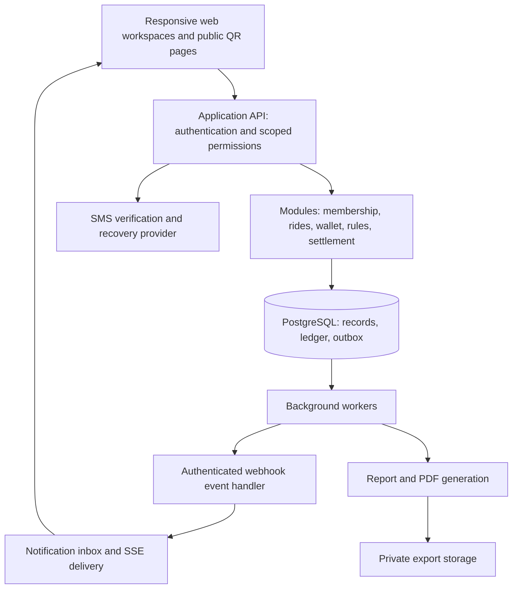

# AlbaTaxi Bonus — Product Requirements Document

Version: 1.3 · 27 October 2026 · Status: Draft for stakeholder review

Revision focus: simpler ride confirmation, unrestricted agency/driver registration, explicit permissions, UI requirements, and a proposed implementation architecture. Sections 18–23 provide the detailed delivery specification; where earlier text offers implementation alternatives, these sections select the proposed default.

Source: [Shared planning conversation — Colaborare firme taxi](https://chatgpt.com/share/6ade34f3-70e4-83ed-bfd6-998efcbc7cf4?ogimg=plain)

## 1. Product summary

AlbaTaxi Bonus is a shared loyalty programme for participating taxi operators in Alba Iulia. Passengers access a mobile website by scanning a QR code, identify themselves, and earn promotional credit in Romanian lei after a driver confirms a completed, eligible ride. Credit can reduce the amount payable on a later eligible ride with any participating operator.

AlbaTaxi provides the common programme identity and administration. Participating operators retain their own legal identities and contribute to a common reward fund. The product must make passenger balances, operator contributions, redemptions, and reimbursements traceable.

This document converts the conversation and subsequent user requirements into a buildable MVP specification. **Confirmed** means explicitly requested by the user in the source chat or follow-up. **Proposed** means recommended in that chat or added here to resolve implementation details; it requires stakeholder approval before launch. Selected defaults in the chat’s interactive questionnaires are not treated as confirmed decisions.

## 2. Problem and outcomes

The proposed AlbaTaxi collaboration needs a practical reason for customers to return and a transparent way for operators to share loyalty costs. Shared vehicle branding alone does not provide either capability.

The MVP should:

- Make enrolment and reward collection possible from a phone without installing an app.
- Reward completed rides while preventing duplicate awards and unauthorised spending.
- Support earning with one operator and redemption with another.
- Give each partner evidence of its programme activity and financial position.
- Establish whether a small pilot improves repeat usage at a sustainable cost.

## 3. Decisions and assumptions

| Item | Status | Requirement or working assumption |
|---|---|---|
| Location | Confirmed | Alba Iulia |
| Reward | Confirmed | Credit denominated in lei for future rides |
| Ride validation | Confirmed | Confirmation by the driver |
| Platform | Confirmed | Mobile website reached through QR |
| Funding | Confirmed | Common fund contributed to by partners |
| Partner roster | Unconfirmed | AlphaTaxi and ConfortTaxi are discussed candidates; verify participation and legal entities |
| Earn rate | Confirmed configurability; proposed default | Admin-only setting per agency, or per independent driver; initial example 5% of eligible non-credit payment |
| Redemption limit | Confirmed configurability; proposed default | Admin-only setting per agency, or per independent driver; initial example 30% of eligible fare |
| Contribution rate | Proposed | 5%; contribution base and payment timing require agreement |
| Pilot fleet | Proposed | 15 taxis; the chat suggests a broader range of 10–20 |
| Pilot duration | Proposed | Three calendar months after launch |
| Authentication | Confirmed | Every role logs in with phone number and password; SMS OTP is proposed for phone verification and password recovery, not routine passwordless login |
| Independent drivers | Confirmed | Drivers may register independently; their reward settings are configured individually by an administrator |
| Driver QR page | Confirmed | Driver-specific page with Bonus and Google Reviews QRs, printable and displayable in portrait or landscape |
| Driver layouts | Confirmed | All driver functions work on phones and tablets in either orientation |
| Scan notifications | Confirmed | Connected driver receives real-time in-app notifications through a webhook-driven event flow |
| Reports and verification | Confirmed | Easily configurable/exportable reports; administrator can verify all programme records and activity |
| Registration capacity | Confirmed | No product-imposed maximum for agencies or drivers; administrators can register any number of agencies/drivers, and agencies can register any number of their own drivers |
| Hosting portability | Confirmed | Provider-independent Docker deployment with Docker Compose, documented backup/restore and migration, and deployment verification on a clean supported Linux server |
| Programme administrator | Proposed | AlbaTaxi centralises reporting and settlement; responsible legal entity must be named |
| Interface language | Proposed | Romanian; RON currency and Europe/Bucharest reporting timezone |

Rates, caps, and eligibility rules must be configurable and versioned. Only administrators may change earn rates or redemption caps. Agency-affiliated drivers inherit their agency settings; independent drivers use their own administrator-configured settings. Historical transactions retain the effective settings and rule version applied when posted.

## 4. Users and access

| Role | Main capabilities | Access boundary |
|---|---|---|
| Passenger | Verify phone, identify account to driver, view balance/history, authorise redemption, request support | Own account only |
| Driver | Identify passenger, confirm rides, process authorised redemption, receive scan notifications, print/display own dual-QR page, view own reports | Own activity and minimum passenger information needed; agency-affiliated or approved independent registration |
| Partner manager | Register/invite any number of own drivers, manage own staff and fleet assignments, review activity, export reports, raise disputes | Own operator; no access to another operator’s passenger records; cannot change reward rates/caps or create global administrators |
| Programme administrator | Onboard partners/independent drivers, exclusively configure reward rates/caps, investigate and verify all records, configure/export all reports, post reasoned corrections, prepare settlements | Full programme verification across agencies, drivers, passengers, rides, ledgers, funds, settlements, rule history, notifications, and audit records; audited privileged actions |

Drivers use individual accounts, never shared operator credentials. The agency or independent-driver programme participant and vehicle assignment applicable at confirmation must be recorded with each ride. Independent applicants cannot award/redeem credit until an administrator activates their participation and configures their reward rules. They participate in fund and settlement reporting as their own participant; their contribution terms must be agreed before activation.

## 5. MVP scope

### Included

- Phone-number-and-password accounts for every role, phone verification/recovery, account sessions, and programme terms acknowledgement.
- Driver-owned printable and on-screen Bonus/Google Reviews QR page in portrait and landscape.
- Responsive phone/tablet layouts for every driver function, plus real-time scan notifications.
- Agency and independent-driver participation with admin-only reward configuration.
- Configurable reports and exports, with full administrator verification access.
- Passenger identification token and driver-confirmed ride workflow.
- RON credit balance, earnings, redemptions, transaction history, and reversals.
- Cross-partner redemption and settlement reporting.
- Partner and driver onboarding, suspension, and role-based access.
- Fraud flags, administrative review, complaints, and audit trail.
- Separate optional link to the serving operator’s review page.

### Excluded from MVP

- Native Android/iOS apps; ride booking, dispatch, matching, or live tracking.
- Fare calculation or replacement of the taxi meter, receipt, or ordinary payment process.
- Passenger cash deposits, credit purchases, transfers between passengers, and cash withdrawals.
- Automatic bank transfers or automatic payouts to partners.
- Reward tiers, referrals, paid subscriptions, receipt-photo validation, and dispatch integrations.
- Rewards conditional on leaving a review, review score, or marketing consent.

## 6. Principal journeys

### A. Enrol and earn

1. Passenger scans the vehicle QR and opens AlbaTaxi Bonus.
2. Website explains the programme and current terms before registration.
3. Passenger registers with phone number and password and verifies the phone using the proposed SMS flow; returning users log in with phone number and password.
4. Website retains the scanned driver context through login and creates an authenticated passenger-ready request in that driver’s queue; it also displays a short-lived identification QR/code as a fallback.
5. After completing the ride, the authenticated driver opens the matching passenger-ready request and enters the fare. If the request is unavailable, the driver scans or enters the passenger identification code.
6. Driver reviews passenger identifier, operator, vehicle, fare, and reward calculation, then confirms.
7. Server validates eligibility, permissions, duplicate protection, and limits; it posts the ride and credit atomically.
8. Passenger sees the confirmed ride and updated balance. Pending or failed submissions must not appear as awarded credit.

**Proposed implementation:** the vehicle QR opens the programme only; it is not proof of a ride. A passenger code identifies an account but does not authorise spending.

The Bonus QR contains an opaque driver-specific identifier. When the landing page opens, the server records a scan/open event and notifies that driver if connected. After authentication, a distinct event may identify the passenger using only the information needed for confirmation. The driver still confirms a real completed ride; scans never award credit automatically.

### B. Redeem and earn on the remaining paid amount

1. Driver identifies the passenger and enters the completed ride’s eligible fare.
2. Server calculates available credit and the maximum permitted redemption.
3. Passenger chooses the amount to use and approves a transaction bound to that ride, fare, driver, and operator.
4. Driver reviews the credit applied and remaining amount to collect through the normal payment process.
5. On final confirmation, the server consumes the redemption authorisation, debits credit, records reimbursement due, and awards any new credit on the eligible non-credit portion in one transaction.
6. Both users receive a clear result with fare, redeemed credit, remaining payment, credit earned, and resulting balance.

Short-lived, single-use redemption authorisation is an added MVP requirement: driver confirmation alone must not permit unauthorised spending of a passenger’s balance. The final confirmation must recheck current balance and caps.

### C. Correction or dispute

Passenger or partner reports a transaction through one programme support channel. An administrator reviews the ride and audit trail, records a reason and outcome, and posts linked compensating entries where needed. Posted history is preserved. A correction affecting already-spent credit enters a manual recovery workflow; it must not silently produce spendable negative credit or charge a passenger.

### D. Partner settlement

Administrator prepares a monthly statement. Each partner reviews contributions due, contributions received, credit awarded, credit redeemed on its rides, reimbursement due, and adjustments. Disputed items are identified separately. Approved settlement and payment references are recorded manually, without altering historical ride entries.

### E. Driver QR page: print or display

Driver opens “My QR page” and previews a branded page containing two clearly labelled codes: “AlbaTaxi Bonus” and “Google Reviews”. The review destination is the assigned agency listing, or the approved listing for an independent driver. Driver selects portrait or landscape, then prints using an A4-friendly print layout or displays the page on a phone/tablet. On-screen layout adapts when the device rotates; the driver can also select an orientation for the print preview. Printed output excludes navigation and private account details. Codes remain readable and usable in both layouts. If no review destination is configured, show a clear setup status and do not generate a misleading review code.

### F. Configure and export reports

Authorised users select a report, date range, available participant/driver/vehicle filters, status, columns, grouping, and sorting through labelled controls. They can save report presets and export CSV, XLSX, or PDF. Drivers see their own data, partner managers their agency data, and administrators all programme data. Exports use the same filters, scope, and totals as the preview and include generation time, reporting timezone, and applied filters. Administrators can drill from totals to source rides, ledger entries, rule versions, adjustments, settlements, and audit events to verify discrepancies.

### G. Real-time scan notification flow

Use a server-side webhook/event handler for driver QR landing events, followed by delivery to the connected driver web session through SSE or WebSocket. Webhooks operate between server components; the phone/tablet browser receives the resulting in-app event. Event processing must authenticate internal delivery, deduplicate event IDs, retry transient failures, and prevent delivery to another driver. An anonymous scan shows a generic notice; it does not disclose passenger identity. Notifications distinguish Bonus entry, authenticated passenger readiness, and review-link opening.

The Google Reviews QR may use a first-party redirect to record the opening and route to the configured Google listing. A redirect event indicates link opening only, never that a review was submitted. Reconnecting drivers can retrieve recent missed events with timestamps; stale events must not look like new scans. Duplicate event delivery must not generate duplicate alerts or rides. Proposed service target: 95% of scan events displayed within two seconds of server receipt under pilot load. A scan is observable only when the QR URL is opened with network connectivity, not when a camera merely recognises the code.

## 7. Functional requirements and acceptance criteria

| ID | Priority | Requirement | Acceptance criteria |
|---|---|---|---|
| FR-01 | Must | QR entry | Opens a responsive programme page; scanning alone never creates a reward |
| FR-02 | Must | Account login | All roles authenticate using normalised phone number and password; one account per phone may carry authorised roles; verification/recovery OTPs cannot replace routine password login |
| FR-03 | Must | Driver onboarding | Only active agency-affiliated or approved independent drivers with an eligible vehicle and configured reward rules can confirm rides |
| FR-04 | Must | Ride confirmation | Stores unique ride ID, passenger, driver, operator, vehicle, fare, timestamp, and rule version |
| FR-05 | Must | Reward calculation | Server calculates earnings from the eligible non-credit amount; client-supplied reward totals are ignored |
| FR-06 | Must | Duplicate protection | Retries and repeated taps with the same transaction key produce one ride and one set of financial entries |
| FR-07 | Must | Redemption | Requires passenger approval, sufficient available credit, and a valid cap; concurrent attempts cannot overspend |
| FR-08 | Must | Passenger wallet | Shows available credit and readable dated history including corrections; credit is labelled promotional and non-cash |
| FR-09 | Must | Cross-partner use | Eligible credit earned at operator A can be redeemed at B; B’s reimbursement is attributed correctly |
| FR-10 | Must | Audit and corrections | Adjustments require actor, timestamp, reason, and original transaction reference; no silent balance editing |
| FR-11 | Must | Partner reporting | Partner sees only its own detailed operational and settlement data; exports reconcile with posted entries |
| FR-12 | Must | Common-fund reporting | Separately shows cash received, reimbursements paid/due, outstanding passenger credit, and adjustments |
| FR-13 | Must | Risk controls | Enforces configured limits; flagged, held, or rejected actions show a clear status and review path |
| FR-14 | Must | Support | Passenger can report a transaction using its reference; administrator can record resolution |
| FR-15 | Must | Programme controls | Administrator can pause new earnings or redemptions separately; existing balances remain visible |
| FR-16 | Must | Review QR | Driver dual-QR page opens the relevant agency/independent listing; reward eligibility is unaffected by use or rating |
| FR-17 | Must | Print/display QR page | Driver previews and prints own dual-QR page in portrait/landscape and displays it on phone/tablet; both codes scan correctly in each supported layout |
| FR-18 | Must | Responsive driver workspace | Every driver function works on phone/tablet in portrait/landscape; rotation preserves inputs and state, with no clipped controls or required page-wide horizontal scrolling |
| FR-19 | Must | Live scan notification | Connected intended driver receives a webhook-driven in-app event; duplicates, reconnects, anonymous opens, and inactive drivers are handled without leaking data or awarding credit |
| FR-20 | Must | Admin-only scoped reward settings | Agency drivers inherit agency earn rate/cap; independents use own settings; non-admin changes are rejected server-side; changes are versioned and audited |
| FR-21 | Must | Configurable report exports | Permitted filters, columns, grouping, sorting, and saved presets work; CSV/XLSX/PDF exports match preview scope and totals |
| FR-22 | Must | Full administrator verification | Administrator can inspect all programme records and drill from report totals to transaction/audit evidence; passwords, password hashes, and OTP secrets are never exposed |
| FR-23 | Must | Unrestricted registration | No hard-coded or subscription-plan agency/driver count limits; administrator creates any number of agencies/drivers and each agency adds any number of its own drivers |
| FR-24 | Must | Guided bulk onboarding | Single-add, invitation link, and CSV import support duplicate detection, preview, row-level errors, and resumable results; invitations do not create active credentials |
| FR-25 | Must | Passenger-ready queue | Driver opens authenticated scan requests without a mandatory second scan; multiple clients remain distinct and QR context survives login |
| FR-26 | Must | Membership lifecycle | Driver transfers, suspension, invitation expiry, and agency exit preserve attribution and deny new unauthorised transactions |
| FR-27 | Must | Portable deployment | Versioned Docker images and Compose configuration deploy on a clean supported Linux server without application code changes; persistent data and secrets are handled separately |
| FR-28 | Must | Verified migration | Documented backup/restore and cutover preserves balances, ledger, files, QR destinations, and required configuration; a migration rehearsal demonstrates reconciliation and rollback readiness |

## 8. Reward rules and calculation examples

Use integer bani for amounts and explicitly defined decimal rounding. **Proposed:** round earned credit down to a whole ban; round the redemption cap down to a whole ban. Reject negative fares, invalid precision, and values outside approved fare bounds.

For eligible fare F, requested redemption R, available balance B, reward rate e, and redemption cap c:

Resolve e and c from the agency performing the current ride, or from the performing independent driver. Credit earned elsewhere remains redeemable, but the current ride’s provider determines its redemption cap and earn rate. Display those effective rules before passenger approval and store their version with the ride. Proposed: changes take effect for newly created confirmations; an already approved transaction must either retain its bound version until expiry or require fresh approval if recalculated. Moving a driver between agency and independent status never rewrites historical transactions.

- Maximum redemption = min(B, floor-to-ban(F × c)).
- Accepted R must be between zero and that maximum.
- Remaining payment = F − R.
- New credit = floor-to-ban((F − R) × e).

With the proposed 5% earn rate and 30% cap:

| Fare | Starting balance | Credit used | Remaining payment | New credit | Ending balance |
|---:|---:|---:|---:|---:|---:|
| 20.00 lei | 0.00 | 0.00 | 20.00 | 1.00 | 1.00 |
| 40.00 lei | 10.00 | 10.00 | 30.00 | 1.50 | 1.50 |
| 20.00 lei | 10.00 | 6.00 | 14.00 | 0.70 | 4.70 |

Newly earned credit becomes available only after the transaction commits and cannot fund its own ride. The source chat’s example of redeeming 10 lei must therefore use a fare of at least 33.34 lei under the proposed 30% cap.

No cash withdrawal or passenger-to-passenger transfer. Expiry, minimum fare, qualifying fare components, and the treatment of tips must be decided before launch. Do not apply expiry without an approved and disclosed rule.

## 9. Fund and reconciliation requirements

The programme must distinguish promotional liability from cash in the common fund. Issuing credit does not mean cash has been received; a reimbursement becoming due does not mean it has been paid.

Maintain auditable records for passenger credits/debits, operator contributions due/received, reimbursements due/paid, and corrections. Partner contribution rate, base, collection timing, opening reserve, and administration fees are separate settings or contractual decisions.

Reconciliation must demonstrate:

- Passenger closing balance = opening balance + earnings + positive corrections − redemptions − negative corrections − any approved expirations.
- Fund closing cash = opening cash + actual receipts − actual payments.
- Operator reimbursement due corresponds to eligible, committed redemptions on that operator’s rides, net of linked corrections and recorded payments.

**Launch dependency:** designate the fund administrator and agree accounting documents, settlement approval, collection timing, reserve policy, insufficient-fund response, and treatment of outstanding credit when a partner exits. A 5% contribution matching a 5% reward does not also pay technical or administration costs.

## 10. Fraud and security controls

- Individual driver credentials, server-side permissions, and revocable sessions; proposed MFA for administrators.
- Phone-and-password login for passengers, drivers, partner managers, and administrators; securely hash passwords, throttle login attempts, protect recovery flows, and revoke sessions following password reset. Verification/recovery codes are short-lived and single-use. Administrator verification access never includes readable passwords or authentication secrets.
- OTP request/attempt throttling and generic responses that do not expose account existence.
- Single-use expiring passenger tokens; redemption approvals bound to exact transaction details.
- Atomic posting and idempotency for award, redemption, and correction operations.
- Configurable daily reward limit; five rewarded rides per passenger per day is a pilot proposal requiring approval. Any exceptions are audited.
- Configurable alerts for repeated driver/passenger pairings, unusual fare repetition, implausible confirmation frequency, and abnormal award volume.
- Manual review for suspected driver/passenger collusion. Driver confirmation cannot independently prove a physical ride.
- Secure transport, protected stored data, restricted exports, privileged-action logging, and no OTP or complete phone number in routine logs.
- Unavailable network means no confirmed award or redemption. Show retry/recovery instructions; offline credit spending is excluded.

Thresholds, enforcement actions, and review ownership must be approved before activation. Suspensions and corrections need a recorded reason and complaint route.

## 11. Data and privacy requirements

Minimum entities: Account/Credentials, Passenger, Partner/Agency, Driver (affiliated or independent), ProgrammeParticipant, VehicleAssignment, DriverQRPage, ReviewDestination, ScanEvent, NotificationDelivery, ReportPreset, Ride, PassengerLedgerEntry, scoped RuleVersion, RedemptionAuthorisation, FundEntry, Settlement, RiskFlag, SupportCase, and AuditEvent.

Collect phone number, account/security metadata, ride amount and programme participants, transaction timestamps, and credit history. Do not collect birth date, passenger GPS trails, pickup/drop-off addresses, or receipt photos for the MVP.

Before launch, name the responsible entities; approve privacy information, role-specific access, retention periods, account deletion/anonymisation handling, and treatment of records that must be retained. Marketing permission is separate and optional. Programme access and rewards must not depend on accepting marketing or leaving a review. These are product launch requirements; this PRD does not determine legal or tax compliance.

## 12. Experience and service targets

Proposed targets to validate during testing:

- Mobile-first Romanian interface, readable fare/credit labels, accessible forms, clear error states, and keyboard-operable controls.
- All driver screens—including login/recovery, onboarding, QR preview/display/print controls, notifications, ride entry/confirmation, redemption, history, reports/exports, profile, and support—must support phones and tablets in both orientations. Test representative widths from 320 CSS pixels upward, portrait/landscape rotation, touch controls, and the on-screen keyboard. Wide reports adapt through column selection/cards or a contained table region.
- No app installation required. Camera scanning has a manual code-entry fallback.
- Returning passenger identification and driver confirmation completed within 30 seconds in representative usability tests, excluding payment and SMS delivery.
- 95th-percentile award/redemption server response below two seconds under agreed pilot load, excluding third-party SMS latency.
- Daily backups, monitoring for posting failures, and a successful restore exercise before launch. Recovery targets and service ownership must be agreed.

Never show success before server confirmation. After a timeout, recover the existing transaction result before offering another submission.

## 13. Measurement

Instrument QR entry, verification completion, ride submission/confirmation, credit award, redemption attempt/result, risk flag, correction, and settlement approval. Use internal identifiers in analytics rather than raw phone numbers.

| Metric | Definition |
|---|---|
| Enrolment conversion | Verified accounts divided by measured unique entry sessions, with tracking limitations disclosed |
| Activated passengers | Verified passengers with at least one eligible confirmed ride |
| 30-day repeat rate | Activated passengers with a subsequent confirmed ride within 30 days, using only cohorts with a complete window |
| Redemption participation | Passengers redeeming credit divided by activated passengers in the defined period |
| Credit utilisation | Redeemed lei divided by awarded lei for the stated period/cohort; report outstanding credit separately |
| Programme cost per active passenger | Defined operating costs divided by passengers with a confirmed ride in the period |
| Risk/dispute rate | Flagged or disputed rides divided by confirmed rides; track confirmed abuse separately |
| Settlement accuracy | Unexplained discrepancies and unresolved disputed lei per settlement period |

Set commercial success thresholds and baseline measurements before launch. Repeat rides observed in the programme do not alone establish incremental growth caused by the programme.

## 14. Delivery and pilot

Indicative sequence from the chat, subject to a delivery estimate:

1. Week 1: confirm partners, accountable owners, fleet, commercial rules, and fund model.
2. Week 2: approve passenger/driver journeys, terms, data requirements, settlement rules, and calculation examples.
3. Weeks 3–5: implement and demonstrate passenger, driver, partner, and administrator workflows.
4. Week 6: reconcile test transactions, test failures/concurrency, train drivers, and verify operational readiness.
5. Three-month pilot: launch with the agreed fleet, review risk weekly, settle monthly, and evaluate mature customer cohorts at completion.

Do not equate a 12-week schedule automatically with three calendar months; establish actual pilot dates when launch is scheduled.

## 15. Release acceptance

Release requires successful end-to-end verification of:

- Phone-and-password login for every role, registration verification, password recovery, OTP expiry/throttling, returning sign-in, and driver suspension.
- Driver dual-QR printing in A4 portrait/landscape, and scanning both printed and on-screen codes on phone/tablet in both orientations.
- Every driver workflow on phone/tablet in portrait/landscape, including rotation and keyboard visibility without lost input or inaccessible actions.
- Live webhook-driven scan notifications, correct driver routing, duplicate delivery, anonymous privacy, reconnect recovery, and review-link opening distinguished from review submission.
- Agency-inherited and independent-driver reward rules, admin-only editing, cross-provider caps, audited changes, and preserved historical versions.
- Report filters/presets, CSV/XLSX/PDF output parity, scoped access, and administrator drill-down verification across all programme records.
- Exact calculation examples, zero/invalid amounts, cap boundaries, and rule version changes.
- Duplicate taps/retries, concurrent redemptions, expired approvals, and unauthorised role access.
- Cross-partner earning/redemption and reconciled passenger, partner, and common-fund reports.
- Reversal before and after credit has been spent, with manual handling of recovery cases.
- Network interruption before/after commit and recovery without duplicate financial effects.
- Backup restoration, operational alerts, support ownership, and approved programme/fund documents.

No unresolved discrepancy in test balances or settlement totals is acceptable at launch. Freeze further rollout if unexplained financial discrepancies appear during the pilot.

## 16. Budget context

The source chat proposed a one-time pilot envelope of **5,150–12,500 lei** and monthly technical/SMS/maintenance costs totalling **180–750 lei**, excluding the reward fund. These are historical planning assumptions from the conversation, not verified quotations or a delivery commitment. Obtain an itemised estimate against this PRD, including SMS usage, support, security, reporting, and settlement work.

## 17. Decisions required before launch

| Decision | Proposed accountable owner |
|---|---|
| Participating legal entities, programme/fund administrator, fleet and pilot dates | AlbaTaxi + partner principals |
| Earn rate, redemption cap, contribution base/timing, reserve and administration funding | Programme owner + partners + accountant |
| Eligible fare, rounding, expiry, limits and insufficient-fund behaviour | Product owner + partners |
| Redemption approval UX and driver identity/account recovery | Product + engineering |
| Settlement cadence, dispute deadlines, correction authority and partner exit treatment | Operations + partners + accountant |
| Programme terms, privacy roles, retention, and applicable operating requirements | Responsible entities + appropriate advisers |
| Support contact, review turnaround, incident ownership and recovery targets | Operations + engineering |
| Pilot baseline, commercial thresholds, reporting access and expansion criteria | Programme owner + partners |

## 18. Registration, agency structure, and permissions

### Capacity and ownership

There is no product-imposed cap on registered agencies, drivers per agency, independent drivers, or agency staff. The pilot fleet is a rollout choice, never a database or licensing restriction. Administrators may create any number of agencies and drivers; agency managers may create or invite any number of drivers within their own agency. Agency accounts do not create other agencies or change global permissions. Security throttling and infrastructure capacity remain operational controls, not registration quotas.

Use these terms consistently: **agency** is an operator organisation; **programme participant** is either an agency or an independent driver responsible for its own settlement; **account** is a person’s phone/password identity; **membership** grants an account a role in an agency. An agency may have multiple managers, and a person may hold several authorised roles. A role/context switcher must clearly show which workspace is active.

Proposed MVP: a driver has one active operating agency membership or independent status at a time, plus historical memberships. Multiple simultaneous operating affiliations are deferred until their financial attribution is specified. This does not restrict the total number of drivers or agencies.

### Guided onboarding

Administrator creates an agency, assigns its manager, configures reward settings, and activates the agency after the required programme setup. An active agency manager can add drivers individually, share a single-use invitation link, or import a CSV template. A joining driver verifies ownership of the phone, sets their own password, accepts the invitation, and selects an eligible assigned vehicle. Inviting an existing account proposes a membership; it never overwrites that person’s password or silently moves them from another agency.

Independent registration creates a pending applicant for administrator review. Agency managers may activate their own accepted driver memberships once the agency and vehicle are eligible; an administrator can override or suspend any participant. Agency setup checklist: manager assigned, reward rules configured, funding terms recorded, review destination configured or explicitly unavailable, and at least one eligible driver/vehicle before the first ride.

CSV import uses preview → validate → confirm → results. Normalise phone numbers, check duplicates and conflicting memberships, show row errors, and allow valid rows to proceed only with a clearly stated partial-import choice. Retry must not duplicate accounts or invitations. Store import actor, source, outcome, and row references; never distribute shared or plaintext passwords. Do not send SMS invitations automatically during upload; make “Send invitations” a separate explicit action with a recipient count.

### Lifecycle and authority

| Action | Administrator | Agency manager | Driver |
|---|---|---|---|
| Create agencies or approve independents | All | No | Apply as independent only |
| Register/invite agency drivers | Any agency | Own agency | Accept own invitation |
| Activate/suspend driver membership | Any | Own agency, except admin-imposed suspension | No |
| Set earn rate/redemption cap | Any participant | Read own effective settings only | Read own effective settings only |
| Configure review destination | Any | Own agency, validated and audited | Independent driver submits for admin approval |
| View/export operational records | All | Own agency | Own activity |
| Correct posted financial entries | Audited administrator action | Request correction | Request correction |

Membership transfer requires acceptance and an effective timestamp; previous rides remain with their original participant. Revoke prior agency access and invalidate uncommitted ride approvals when operating affiliation changes. Suspension blocks new confirmations/redemptions immediately, including existing sessions, while authorised history remains available. Agency closure must not cascade-delete rides, balances, or settlements.

## 19. UX/UI specification

### Navigation and essential screens

| Workspace | Primary navigation | Default screen |
|---|---|---|
| Passenger | Balance, History, Help, Account | Balance, current ride request, and a clear “Use credit” action when eligible |
| Driver | Ride queue, My QR page, History, More | Connection status and authenticated passenger-ready requests |
| Agency | Overview, Drivers, Vehicles, Reports, Settings | Setup checklist or activity summary with pending invitations |
| Administrator | Overview, Agencies, Independents, Transactions, Fund, Reports, Audit/Support | Reconciliation exceptions, pending approvals, and actionable alerts |

Keep the frequent driver workflow to **select passenger → enter fare → review/confirm**, with passenger approval added only when redeeming. Use a numeric keypad, Romanian decimal formatting, persistent fare labels, and large touch controls (proposed minimum 44 × 44 CSS pixels). Show “Fare”, “Credit used”, “Amount to collect”, and “Credit earned” separately; the amount to collect is most prominent on the final driver screen. Confirmation is a deliberate action; Enter or rotation must not accidentally post a ride.

Passenger-ready requests display a short matching code, masked phone suffix, and arrival time. The passenger sees the same matching code. Never auto-select the newest scan or merge different passengers. Duplicate opens from the same passenger/session may collapse into one request. Anonymous scan events go into a quiet activity indicator; authenticated passenger readiness receives the actionable alert. This avoids a stream of low-value pop-ups while preserving scan visibility.

Every data screen has loading, empty, success, validation-error, permission-denied, and disconnected states. Errors preserve safe input and offer a specific next action. Use text and icons alongside colour. Password fields support show/hide, password managers, and paste; phone fields show country prefix and validation before submission. Routine login remains phone plus password for all roles.

### QR display and print

Portrait display stacks the two labelled codes; landscape places them side by side when space permits. Provide “Display only” and “Print” actions with previews. Public display mode contains only programme branding, driver/agency public identifier, instructions, and QRs; it hides passenger requests, balances, account navigation, and private notifications. A driver exits display mode into an authenticated workspace. A separate passenger-facing tablet can use a revocable display-only link that grants no driver permissions.

Keep QR destinations short and stable with opaque identifiers and a quiet zone. Proposed print target: at least 35 mm square per QR on A4; validate by scanning representative printed copies and real devices. Print CSS must avoid splitting a QR or its label across pages. Provide a downloadable print-ready PDF in both orientations. A review destination can change without reprinting because the public QR resolves through the programme domain. Driver/agency affiliation changes must visibly update branding and must not silently send scans to a new owner; revoke or reissue identifiers when ownership changes.

### Reporting usability

Start with ready-made templates: rides and earnings, redemptions, driver activity, participant settlement, fund reconciliation, and audit exceptions. Default to a useful recent period. Put advanced filters behind an expandable panel and show active filter chips with “Clear all”. Save named presets, remember column choices, and provide a totals summary before export. Export large results as a background job with progress, completion, retry, and a private download link. Recheck permissions at generation and download time; expire files according to a defined retention setting. Protect spreadsheet exports from formula injection and log sensitive exports.

## 20. Proposed technical architecture

This is a proposed design for estimation and implementation, not a claim about an existing codebase. Start with a modular application and a relational database, with separately runnable background workers. Keep financial posting in a single transactional boundary; scale web instances and workers as demand grows.

### Components and boundaries

- **Responsive web client:** passenger, driver, agency, and administrator workspaces, plus public QR/display pages; no sensitive data cached by a service worker. Framework choice belongs in the implementation estimate.
- **Application API:** server-side authorisation and input validation for every request; clients never decide membership, fare eligibility, reward rate, balance, or financial posting outcome.
- **Domain modules:** identity/access; agencies/memberships/vehicles; QR and passenger-ready requests; ride workflow; rules; wallet/ledger; fund/settlement; reports; notifications; audit/support.
- **PostgreSQL:** authoritative financial and operational state, foreign keys, uniqueness constraints, indexed participant/timestamp queries, and transactional posting. Wallet row locking or an equivalent serialisable strategy prevents concurrent overspend; lock contention and retries need explicit handling. See [PostgreSQL locking documentation](https://www.postgresql.org/docs/current/explicit-locking.html).
- **Workers and transactional outbox:** create an event record in the same commit as the originating state change; workers deliver notifications and exports with retry and dead-letter handling. A delivery failure never rolls back an already committed ride, and notifications cannot create ledger entries.
- **Webhook delivery:** signed server-to-server events with event ID, timestamp, schema version, minimal payload, replay protection, and retry. Keep this internal to the programme unless an external integration is explicitly commissioned; no public subscription feature is required for MVP.
- **Browser events:** proposed SSE for server-to-browser alerts, with ordinary HTTPS requests for driver actions. SSE is one-way, which suits this split; see [MDN’s SSE documentation](https://developer.mozilla.org/en-US/docs/Web/API/Server-sent_events/Using_server-sent_events). Use a durable notification inbox, resumable event cursor, heartbeat, and reconnect catch-up. Backgrounded mobile browsers may suspend connections: show connection state and reconcile on focus. Guaranteed closed-app push alerts are outside MVP.
- **Private file storage:** asynchronous CSV/XLSX/PDF exports with owner/scope metadata and expiring authorised downloads. No public export bucket.

### Tenant isolation and identity

Every agency-owned record carries its agency/participant ID. Resolve permitted scopes from the authenticated account and membership on the server, never merely from a request’s agency ID. Scope list queries, detail queries, live channels, exports, and background jobs consistently. Database constraints should prevent linking an agency’s ride to another agency’s vehicle assignment. Passenger wallets are programme-wide; a driver receives only the specific passenger information needed for the current authorised interaction. Programme administrators have explicit global permissions with audited access to sensitive records.

Store phone numbers in a canonical international format, timestamps in UTC, displayed/reporting time in Europe/Bucharest, RON amounts as integer bani, and percentage rates as integer basis points. Use secure HttpOnly session cookies with appropriate SameSite settings, CSRF protection for mutations, and server-side session revocation. Passwords use an established adaptive password hashing library; no custom cryptography.

## 21. Transaction contracts and state models

Proposed API resource groups: `/auth`, `/agencies`, `/memberships`, `/drivers`, `/vehicles`, `/qr-pages`, `/passenger-requests`, `/rides`, `/redemption-approvals`, `/wallet`, `/rules`, `/reports`, `/exports`, `/settlements`, and `/events`. Document request/response schemas and role scopes before implementation. Public endpoints accept opaque QR identifiers, never writable participant settings.

Mutating financial endpoints require an idempotency key scoped to actor and operation. Reusing a key with different inputs returns a conflict. Return stable transaction IDs and machine-readable statuses/errors such as `INSUFFICIENT_CREDIT`, `APPROVAL_EXPIRED`, `PARTICIPANT_SUSPENDED`, and `RULE_CHANGED`, plus clear Romanian messages. After a timeout, clients query the existing operation rather than generate a new key.

| Resource | States and key rules |
|---|---|
| Invitation | Pending → accepted, expired, or revoked; acceptance verifies account ownership |
| Agency/independent participant | Draft/pending → active → suspended or closed; activation requires valid rules and fund setup |
| Passenger-ready request | Ready → claimed → completed, cancelled, or expired; claim prevents parallel processing; eligibility is rechecked at posting |
| Ride | Draft → awaiting passenger approval when redeeming → ready → posted, or cancelled/expired; corrections reference posted records |
| Redemption approval | Pending → approved → consumed, or declined/expired/revoked; binds exact fare, credit, provider, passenger, and rule version |
| Export | Queued → running → ready, failed, or expired; cancelled when authorisation is withdrawn |
| Settlement | Draft → under review → approved → paid or partially paid; later corrections enter an auditable subsequent adjustment |

Proposed rule-version decision: bind the fare preview and approval to a rule version for a short configurable period. Changing fare, redemption amount, provider, or passenger invalidates approval. Ordinary rate changes do not rewrite an unexpired bound preview; suspension or programme pause overrides it. At final commit, recheck approval, status, vehicle assignment, limits, and current wallet balance. If available credit has changed, request fresh approval instead of silently reducing the passenger’s chosen amount.

Posting performs wallet debit/credit, ledger entries, ride status update, reimbursement obligation, and outbox record in one database transaction. Every amount is reproducible from stored inputs and rule version. Reconciliation compares the wallet projection with the immutable ledger; cached balance is never independently editable. Reversal links to the original financial entries and preserves evidence. Do not physically delete financial history through administrative screens.

## 22. Scale, observability, and operations

Unlimited registration means the data model and UI do not impose a business count limit; it does not promise infinite simultaneous load on fixed infrastructure. Use server pagination/search for agency, driver, passenger, ride, and audit lists; never load all records into a dropdown. Bulk jobs process bounded batches. Index common tenant/date/status queries, use background exports, and isolate heavy report execution from transaction traffic. Adding an agency or driver must not require a deployment or schema change.

Proposed initial engineering benchmark, separate from the pilot fleet: 1,000 agencies, 50,000 driver records, 1 million historical rides, 2,000 connected driver sessions, and 20 completed ride postings/second sustained for 15 minutes. These are test scenarios, not registration ceilings or promised capacity. Record hardware, data distribution, error rate, and latency; tune or scale infrastructure if the agreed benchmark fails. Retain the proposed sub-two-second 95th-percentile transaction and scan-notification targets under that load. Test bulk registration and export concurrently with ride posting.

Monitor API errors/latency, login failures, posting conflicts, reconciliation differences, outbox backlog, notification delivery lag, webhook retries, export queue age, SMS failures, database health, and backup success. Correlate a request/event across components without logging passwords, codes, or unnecessary passenger details. A financial discrepancy alerts the administrator and supports pausing affected operations; an SMS outage must not log out already authenticated users.

Proposed production recovery targets for costing: recovery point no older than 15 minutes and restoration within four hours, supported by database backups and recovery logs. These replace the earlier daily-backup-only minimum and require a successful restore exercise. Keep staging and production data/credentials separate, review migrations before deployment, and rehearse rollback/recovery for changes to financial logic. Estimate infrastructure, SMS, storage, reporting, monitoring, and support against these requirements; the original chat budget must be re-estimated for this expanded scope.

## 23. Additional release gates and implementation order

1. **Identity and tenancy:** phone/password accounts, membership roles, unrestricted single/bulk registration, duplicate handling, transfers, and tests proving cross-agency access is denied for APIs, events, and exports.
2. **Ride and ledger:** passenger-ready queue, fallback code, calculation/version rules, authorisation, concurrent redemption, atomic posting, corrections, and exact reconciliation.
3. **Driver experience:** all workflows on phone/tablet in both orientations; public display privacy; printable/downloadable dual-QR layouts; successful scan tests; connection and recovery states.
4. **Notifications and reporting:** durable webhook-driven events, deduplication and reconnect handling, configured templates/presets, private exports, administrator drill-down and verification.
5. **Operational readiness:** scale benchmark, concurrent import/export load, recovery exercise, clean-server Docker deployment and migration rehearsal, monitoring, support runbook, funded settlement model, and pilot success criteria.

## 24. Docker deployment and hosting portability

### Deployment contract

Deliver a provider-independent Linux container deployment that can move between a Docker-capable VPS, such as Hostinger VPS, and an AWS virtual machine without application code changes. Other container platforms may require deployment adapters; compatibility with every hosting plan or managed container service is not assumed. Publish supported Linux, CPU architecture, Docker Engine/Compose versions, and minimum resource requirements after verification. A regular shared website hosting plan is suitable only if it explicitly supports the required containers and services.

The delivery package must include:

- Versioned Dockerfiles, immutable release image tags/digests, and production Docker Compose configuration for the application, background worker, PostgreSQL, and HTTPS reverse proxy. Any additional runtime dependency must be declared explicitly.
- An example environment configuration containing names and safe placeholders only, plus instructions for injecting production secrets. Configure domain, public base URL, database connection, SMS provider, file storage, webhook credentials, and operational settings outside application code.
- Health/readiness checks, restart policies, service dependency handling, graceful shutdown, and persistent storage definitions. A single documented startup procedure must deploy the services after prerequisites and secrets are supplied.
- A deployment runbook covering DNS, HTTPS certificate provisioning/renewal, firewall exposure, database migrations, initial administrator creation, updates, backup/restore, and troubleshooting. No default production password or public administrator registration.

Run containers with minimum required privileges and keep PostgreSQL/internal services off public ports. A container restart or image replacement must preserve database records and stored files. Export files, uploaded assets, and required generated documents must use documented persistent volumes or configurable external storage; container-local writable layers are never the only copy. Container images must not contain secrets or production data.

Docker packages runtime dependencies; database contents, persistent files, secrets, DNS, certificates, and external service configuration require separate migration. Support an external PostgreSQL connection and configurable storage so these services can move independently. Infrastructure-specific adapters must remain outside core ride, wallet, and settlement logic.

### Migration and cutover procedure

1. Provision the destination with verified resource capacity, supported container runtime, network access, configuration, and secrets. Deploy the same approved release and compatible database version; do not combine a host migration with an untested database upgrade.
2. Restore a consistent database backup and copy required persistent files into an isolated destination. Preserve account/security configuration needed to interpret stored data; transfer secrets securely. Verify schema, record counts, file availability, wallet/ledger reconciliation, and pending settlement totals.
3. Rehearse the final cutover. For the initial Compose deployment, use a planned maintenance window: pause writes and workers on the source, take the final consistent backup, restore it, and ensure only the destination processes jobs and financial writes. Do not run two independent writable copies of the programme.
4. Configure the existing public domain and HTTPS on the destination, update DNS/routing and any provider allowlists or callbacks, and verify QR links, phone/password login, ride confirmation, redemption, scan notifications, exports, and background jobs. Keep test actions isolated or explicitly reconciled.
5. Resume operations only after reconciliation passes. Keep the source unavailable for writes during the agreed rollback period. Before destination writes resume, rollback may return to the frozen source; after new destination transactions exist, rollback requires a controlled transfer of those writes rather than restoring an older source and losing activity.

Use a programme-owned stable domain in printed Bonus and review QR codes. Changing hosting must not require reprinting cards when that domain and public paths remain unchanged. Preserve opaque identifiers and review redirects. Expiring sessions or download links during migration must produce a clear re-login/regeneration path without losing financial records.

### Acceptance criteria

- Deploy an approved release on a clean supported Linux server using only the supplied images, configuration, secrets, and runbook; no application source edits or undocumented manual fixes.
- Restart/recreate application and database containers and demonstrate persistence of accounts, rides, wallet entries, rule history, settlements, and required files.
- Complete a backup/restore and migration rehearsal between two separate server environments; document elapsed time, downtime, checks, limitations, and rollback decision points.
- Verify unchanged public-domain QR links, correct TLS routing, role access, live events, export generation, and exactly one active job-processing/write environment after cutover.
- Reconcile passenger balances and fund/settlement records before and after migration with no unexplained differences. Validate restored backups against the recovery targets in section 22.

The clean-server deployment and migration rehearsal are release requirements. Demonstrating one compatible Linux deployment does not certify every Hostinger or AWS product; the selected destination must satisfy the published deployment contract. Provider-specific managed services and zero-downtime migration can be added later if required and separately estimated.

Before sign-off, conduct task-based usability testing with representative passengers, drivers, an agency manager, and an administrator. Users should complete enrolment, a returning passenger ride, credit approval, QR printing, driver invitation, and report export without facilitator intervention. Record task success, time, errors, and confusing language; fix critical failures before pilot. Architecture choices and engineering benchmark are proposed defaults for estimation, while unrestricted registration and the user’s previously confirmed requirements remain mandatory.

